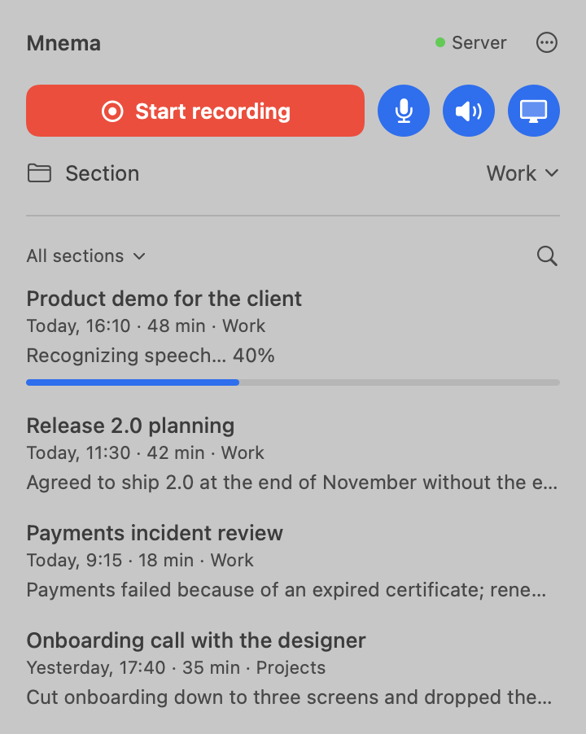
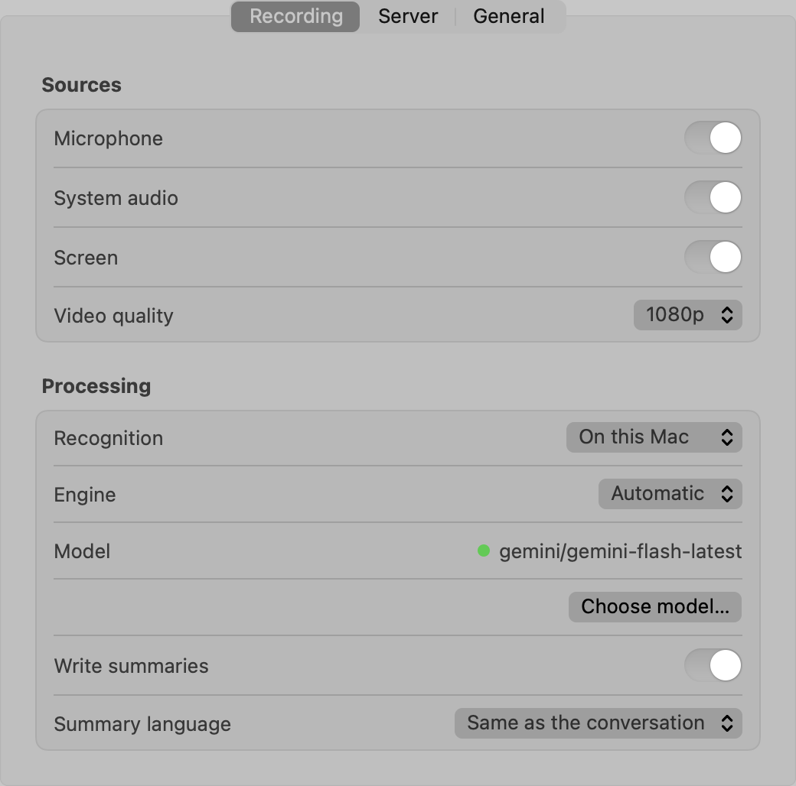

# Mnema

**Record a call, get a transcript and a short summary.** Speech is recognized on your Mac or on
your own server; only the transcript text goes to the language model you choose. One server can
serve several people, each with their own devices, library and model.


[Read this in Russian →](README.ru.md)

<p align="center">
  <picture>
    <source media="(prefers-color-scheme: dark)" srcset="docs/images/panel-dark.png">
    
  </picture>
</p>

## Features

- **One-click call recording** from the macOS menu bar, the Linux top panel or an Android phone.
  Your microphone and the other side of the call are kept as two separate tracks. On a Mac it
  can also record the screen into one `video.mp4` with the sound.
- **Local speech recognition** with Parakeet Ultra: 25 European languages, on the Neural Engine
  of your Mac or on the CPU of your server. No audio leaves your machines unless you choose cloud
  recognition (OpenAI), which is also the only place for the languages Parakeet doesn't know.
- **A title and a short summary** of every recording with text, from a cloud model of your
  choice: Gemini, DeepSeek, OpenAI, Claude, Qwen, OpenRouter or Groq. Free tiers are enough for
  daily use. You choose the model in the Mac app; on a server it is kept per person.
- **Plain files you own**: every recording is a folder with `transcript.txt` and `summary.txt`,
  ready for Obsidian, an LLM or an archive.
- **Your own server** for Linux and the phone, with invites per device and sync of texts
  between all devices. Friends and family can share it: each person gets their own devices,
  recordings library, model and keys.
- **Command line** (a separate package) for files and links: transcribe a video or a YouTube
  link, live captions, translate, compress, merge tracks.
- **MCP server** so Claude and other assistants can transcribe and read your recordings.
- **OpenAI-compatible API** on your server, so other services can transcribe with your Parakeet.
- **English and Russian interface**, following the system language.

## How it works

```
Mac ─────────────── records, recognizes and summarizes on its own
                    (a server is optional: sync, recognition there, or the summary
                    with your model kept there)

Linux desktop ──┐
Android phone ──┼── record ──▶ your Mnema server ── recognizes and summarizes
Command line  ──┘               (with the model of the person who recorded)
```

A Mac needs nothing else. Linux and the phone don't recognize speech themselves: they send the
recording to a Mnema server you run on a Linux machine, at home or on a VPS. The server keeps
the model of every person who uses it, so a person's summaries are written by their own model
and their own key.

## Install

### Mac

Requirements: Apple Silicon, macOS 14.2 or later.

1. Download `Mnema-X.Y.Z.dmg` (about 84 MB) from
   [Releases](https://github.com/fozt/mnema/releases/latest), open it and drag Mnema to
   *Applications*. The app carries what it needs: Python, ffmpeg and `mnema-asr`, the program
   that recognizes speech on the Neural Engine.
2. Open Mnema from *Applications*. The app isn't notarized by Apple, so the first time macOS says
   it couldn't verify Mnema and offers only *Done* and *Move to Trash*: click *Done*, open *System
   Settings → Privacy & Security*, scroll down to *Security*, click *Open Anyway* next to "Mnema
   was blocked", confirm with your password or Touch ID, and click *Open Anyway* once more. macOS
   remembers the choice.
3. Click the Mnema icon in the menu bar, then *⋯ → Settings…*. On the *Recording* tab click
   *Choose model…* and pick a provider, paste its key and choose a model. Mnema checks the key and
   the model before saving. With a server connected, the model and its key are saved on the
   server, under your name; without one, on this Mac.
4. Click *Start recording*. macOS asks for microphone and system audio access the first time.

<p align="center">
  <picture>
    <source media="(prefers-color-scheme: dark)" srcset="docs/images/settings-dark.png">
    
  </picture>
</p>

**Screen video.** Turn on *Screen* next to *Microphone* and *System audio* to record the screen
the active window is on, together with the sound. macOS asks for screen recording access when you
turn it on and applies it after Mnema restarts, so quit and reopen Mnema after allowing it; until
then the toggle says *Permission needed*. When the recording is processed, the folder gets one
`video.mp4` with the sound, and the card menu offers *Open video*. *Settings → Recording → Video
quality* applies from the next recording: 1080p (default, small text stays readable, up to about
0.9 GB per hour, about 0.4 GB on a calm screen) or 720p (up to about 0.5 GB per hour).

Mnema's own windows never show in the video, in screen sharing or in screenshots. While the screen
is recorded, macOS shows its recording icon in the menu bar, and Mnema cannot hide it: share a
window rather than the whole screen in a call to keep the menu bar out of the share. *Hide
recording in the menu bar* (*Settings → General*, or the panel during a recording) makes Mnema's
own icon look idle. The video is assembled and kept on this Mac, even when the server recognizes
the speech: it is not sent anywhere and does not sync. A recording's menu has *Delete audio* and
*Delete video*; *⋯ → Delete audio and video…* asks which of the two to remove from all processed
recordings (audio is ticked, video is not). Deleted files go to the Trash; the texts stay.

The speech model (about 630 MB) is not in the app: Mnema downloads it once, when you choose
recognition *On this Mac* or make the first recording without it, and shows the progress in the
*Recognition model* row of *Settings → Recording*; while the model is missing, that row has a
*Download* button. It needs a connection and room on the disk; the model lives in
`~/Library/Application Support/Mnema/models`.

Opened straight from the disk image, Mnema asks to be moved to *Applications* first. On its first
start it turns on *Open at login*. The `mnema` command and `mnema-mcp` are installed separately
(see [Command line](#command-line)). Updates come from GitHub Releases: *⋯ → Settings… → General
→ Check for updates* looks for a new version, and when there is one, *Update* downloads it and
replaces this app in place, so Mnema has to stay in a folder you can write to, such as
*Applications*. When only Mnema's own code changed, the update is about 4 MB instead of the whole
app. To remove Mnema, turn off *Open at login* (*Settings → General*), quit it and move it to the
Trash; settings stay in `~/.config/mnema`, recordings in `~/mnema`, the speech model in
`~/Library/Application Support/Mnema`. The licenses of everything inside the app are in
`Mnema.app/Contents/Resources/licenses`; the source code of its LGPL and GPL parts is in
`third-party-sources-X.Y.Z.tar.gz` on the same release page, except the ones that
`licenses/SOURCE-OFFER.txt` lists as on request. The speech models have their own licenses, see
[Speech models](#speech-models).

### Server (Linux)

Needed for Linux desktops and the phone. The server runs in Docker on a Linux machine (x86_64 or
arm64), at home or on a VPS, and recognizes speech on the CPU. Install
[Docker Engine with the Compose plugin](https://docs.docker.com/engine/install/) first. A
recognition job takes up to about 2 GB of memory; the installer offers to add 4 GB of swap when
there is none (`--swap-size 4G` does it without asking, `--swap-size 0` never asks).

```bash
git clone https://github.com/fozt/mnema.git && cd mnema
./install.sh server
```

The installer starts the `mnema` container from the published image. Speech is recognized by
Parakeet Ultra on ONNX Runtime, on the CPU; the model (about 910 MB) is downloaded into
`data/cache` on the first job. The installer prints an invite: a link like
`http://host:port#invite=…` that connects one device of the owner and expires in 6 hours. The
server has no model of its own: each person sets theirs in the Mac app (see
[Choosing a model](#choosing-a-model)).

The invite carries the server's address, which the installer finds on its own (Tailscale, a public
IP or the home network). If devices reach the server another way, for example by a domain name or
through port forwarding on a router, give that address with `--url http://my.host:port`. Later
installs keep it.

Open the port the installer prints in your firewall. Docker publishes it past `ufw`, so `ufw`
rules do not close it: use your provider's firewall for that.

Everything lives in `~/mnema-server`: `compose.yaml` with its `.env`, and the data (settings,
recordings, devices, model weights) in `data/`. Nothing else is installed on the machine. The
server's commands run from the folder you cloned, next to `install.sh`:

```bash
cd ~/mnema && ./mnema.sh invite
```

| Command | What it does |
|---|---|
| `./mnema.sh invite` | A new invite for a device of the owner (`--hours` up to 72; `--user NAME` for a device of that person) |
| `./mnema.sh users` | People of the server with their devices and models |
| `./mnema.sh users add NAME` | Add a person and print their invite |
| `./mnema.sh users remove NAME` | Disconnect all of a person's devices; their recordings stay |
| `./mnema.sh devices` | Connected devices; `./mnema.sh devices revoke <id>` disconnects one |
| `./mnema.sh update` | Pull the latest image and restart the server with it, always: a changed server config applies |
| `./mnema.sh logs` | Server log |

`./install.sh server --build` builds the image from the checkout instead of pulling it.

The server speaks plain HTTP and requires a token from every device. If the network between your
devices and the server is not trusted, put a TLS proxy in front of it.

#### Several people on one server

Every person has their own devices, recordings library, model and keys. One person never sees
another's recordings, jobs, uploads or settings; the owner (the first user, whose invite the
installer prints) is a person like the others. To add someone:

```bash
cd ~/mnema && ./mnema.sh users add anna
```

Send the printed invite to that person. The name is lowercase Latin letters, digits, `-` and `_`.
`./mnema.sh invite --user anna` makes another invite for a person's second device, and
`./mnema.sh users remove anna` disconnects all of their devices at once. The recordings stay on
disk; adding the same name again brings them back.

When a device connects to a server whose recordings library is not the one it synced with
before, the app asks before sending its recordings there, so a recording cannot end up in someone
else's library by mistake.

The server's files are visible to whoever has access to its disk. The owner can read everyone's
recordings and model keys there: the library of the owner is `~/mnema-server/data/library`, of
anyone else `~/mnema-server/data/users/NAME/library`, models and keys are in
`~/mnema-server/data/config/mnema/users/NAME.env`. Add only people you trust with that.

#### Queue and memory

Recognition jobs from all people share one queue, and a free place goes to the person whose last
job started longest ago, so one long batch does not hold up the others. A recognition job starts
only when at least 2 GB of memory is free (or nothing else recognizes at that moment) and waits
otherwise. By default the server runs one recognition per three CPU cores and splits the cores
but one between the running ones. To set it by hand, add `MNEMA_JOB_WORKERS=2` (jobs at a time)
and `MNEMA_ASR_THREADS=8` (CPU threads of one job, or `auto` for all of them) to
`~/mnema-server/data/config/mnema/.env`. The threads apply to the next job, the number of jobs
after the server restarts (`./mnema.sh update` restarts it). Cloud recognition does not wait
on local jobs and uses no engine memory.

Until a person sets a model in the app, their recordings come back with a transcript and no
summary.

### Linux desktop

Debian or Ubuntu with GNOME, KDE, Xfce, Cinnamon or MATE. On plain GNOME (Fedora, Arch) enable the
*AppIndicator and KStatusNotifierItem Support* extension.

```bash
git clone https://github.com/fozt/mnema.git && cd mnema
./install.sh client 'http://host:port#invite=…'
```

Mnema appears in the applications menu and in the top panel, and the installer adds the `mnema`
command. Without a server it only records: a recording stays *Not processed*, and after you
connect a server in *Settings → Server* you can process it with *Process…* on its card.

### Android

Android 14 or later. Recording the other side of a call is tested only on Pixel phones: on
other phones Mnema may record only your microphone, and it tells you when call audio is missing.

1. Download `mnema-X.Y.Z.apk` from [Releases](https://github.com/fozt/mnema/releases/latest) and
   install it (allow installs from your browser).
2. Follow the *Getting started* checklist: file access, notifications, no battery
   limits.
3. Start the recording helper. It needs Wi-Fi debugging, which is in *Developer options* (tap
   *Build number* seven times to unlock them). The app walks you through pairing; no computer is
   needed. After a reboot, start the helper again from the record screen.
4. In *Settings → Processing → Server* tap *Add server* and paste an invite from your server.

The phone records both sides of a call as two tracks and keeps recordings in
`Documents/Mnema`. The connected server recognizes and summarizes them with your model; a new
recording can start while an earlier one waits in the server's queue. The list shows each
recording's date, time and length; a long press opens *Rename*, *Move to section* and *Delete
recording*, and a swipe to the left offers to delete it. The phone updates itself from
*Settings → Updates*.

## Using Mnema

**Recordings** live in `~/mnema` on a computer and in `Documents/Mnema` on the phone. Each one is
a folder named after the call, for example `2026-10-21_Release planning`:

| File | What it is |
|---|---|
| `transcript.txt` | The transcript in paragraphs, each with its time and track: `[12:34] mic:` (you) or `system:` (the other side) |
| `summary.txt` | The gist in one or two sentences, then the main points, each with the time it came up |
| `recording.mp3` | Both tracks mixed together |
| `mic.wav`, `system.wav` | The original tracks |
| `video.mp4` | The screen with the sound (Mac, with *Screen* on) |

Rename a recording in the app or in Finder: the folder name is its title. Folders inside `~/mnema`
are sections; move recordings between them from the card menu. Texts sync between your devices
through the server; audio and video stay where they were recorded. A recording deleted on one
device is deleted on the others at the next sync: into the Trash, or for good on a phone without
one.

Recordings wait in a queue while earlier ones are processed, so a new recording can start at
any time. On this computer they go one at a time; on a connected server up to three go at once.
The card of each recording being processed shows its step and progress.

**Language** is detected from the speech. If it comes out wrong, pick it in the menu of the
recording that is being processed, or in *⋯ → Process recording…* for an existing one; the
chosen language is told to cloud recognition and used for cleaning up the text and for the
summary. *Process recording…* processes any recording folder again, all of it or a part, with
its own title, language, recognition and tracks.

**Summaries.** With *Write summaries* on, every recording with text gets a title and a summary,
in the language set in *Summary language* (the conversation's by default). Without a model you
still get the transcript. A recording with text and no summary (no model, the model failed or
summaries were off) has *Summarize* in its menu.

### Recognition

*Settings → Recording → Processing → Recognition* says where speech is recognized:

| Place | Who recognizes | Engines |
|---|---|---|
| On this Mac (Mac only) | The Mac itself, on the Neural Engine | Automatic, Parakeet |
| On the server | Your server, on its CPU | Automatic, Parakeet |
| In the cloud | OpenAI | `gpt-4o-transcribe`, `gpt-4o-mini-transcribe` |

Parakeet Ultra recognizes 25 languages: Bulgarian, Croatian, Czech, Danish, Dutch, English,
Estonian, Finnish, French, German, Greek, Hungarian, Italian, Latvian, Lithuanian, Maltese,
Polish, Portuguese, Romanian, Russian, Slovak, Slovenian, Spanish, Swedish and Ukrainian, and
names the language itself. Other languages need *In the cloud*: *Automatic* does not detect
them, and such speech comes back as a wrong transcript in one of those 25 languages. Audio never
goes to the cloud by itself, so choose *In the cloud* for that recording (*⋯ → Process
recording…*). Only the `mnema` command with an explicit `--lang` outside the list gets the note
"This language is recognized only in the cloud" instead of a transcript.

*On the server* is unavailable until a server is connected. Linux offers *On the server* and *In
the cloud*. The title and the summary are written by your model in every case: a Mac connected to
a server recognizes on its own and asks the server's copy of your model for the summary. If the
server is unreachable you keep the transcript, and the card offers *Summarize* later.

**Cloud recognition sends the audio to OpenAI** and is paid per minute of speech by your OpenAI
account; the other places keep audio on your machines. It uses a key of its own: pick *In the
cloud* and Mnema asks for an OpenAI key (*Set the OpenAI key…*), which is checked and, with a
server connected, kept there under your name. That key has nothing to do with the summary model.
A Mac without a server reads it from `MNEMA_ASR_API_KEY` in `~/.config/mnema/.env`.

### Choosing a model

*Settings → Recording → Choose model…* (Mac). Any provider works; a key takes a minute to get:

| Provider | Where to get a key | Note |
|---|---|---|
| Gemini | [aistudio.google.com/apikey](https://aistudio.google.com/apikey) | Free tier with a daily limit per model |
| OpenRouter | [openrouter.ai/settings/keys](https://openrouter.ai/settings/keys) | Free models; allow them in the privacy settings |
| DeepSeek | [platform.deepseek.com/api_keys](https://platform.deepseek.com/api_keys) | Paid, very cheap |
| OpenAI, Claude, Qwen, Groq | the provider's console | Paid |

One recording costs one request; a transcript longer than the model takes at once goes in
parts. With a server connected, the window saves the model and the key on the server under your
name, and the server uses them for your recordings from every device, Linux and phone included;
they show the model, which is chosen in the Mac app. Keys are shown only masked and are kept in
a file readable by the server alone.

### Live text and translation

`mnema live` shows captions as you speak, through a server: a phrase is recognized when you
pause (or after 15 seconds), together with up to 10 seconds of audio before it as context, so it
appears a moment after it ends instead of word by word. Live translation
(`mnema live --translate`) uses the model too. If you have a DeepL key, set it in *Settings →
Server → Set the DeepL key…* and the server translates phrases with it, otherwise with your
model.

## Command line

The command is a package of its own, installed with [uv](https://docs.astral.sh/uv/) from the
wheel of a release (put the version of the
[latest release](https://github.com/fozt/mnema/releases/latest) in place of `X.Y.Z`):

```bash
uv tool install "mnema[cli] @ https://github.com/fozt/mnema/releases/download/vX.Y.Z/mnema-X.Y.Z-py3-none-any.whl" \
  --constraints https://github.com/fozt/mnema/releases/download/vX.Y.Z/mnema-X.Y.Z-constraints.txt
```

The constraints file holds the versions of the dependencies the release was tested with. The
command installs `mnema` and `mnema-mcp` into `~/.local/bin`; add that folder to `PATH` if your
shell doesn't have it. Update with the same command and `--force` (`mnema update` prints it).
On a Mac the command recognizes through the installed Mnema app, so install the app too, or
connect a server; on Linux it recognizes on the CPU with Parakeet or on a server. The Linux app
installer adds the command itself.

```bash
mnema transcribe meeting.mov                    # → meeting.txt
mnema transcribe "https://youtu.be/VIDEO_ID"    # anything yt-dlp can download
mnema transcribe call.m4a --translate           # also a translation, call.ru.md
mnema rec --system                              # record mic and system audio, Ctrl-C to stop
mnema finish ~/mnema/2026-10-21_08-35 --from 0:10 --to 1:35   # process a part of a recording
mnema compress screen.mov                       # HEVC, much smaller
```

| Command | Purpose |
|---|---|
| `transcribe` | Speech to text; files, folders and links, several at once |
| `translate` | Translate a transcript or a media file with the model |
| `rec`, `finish` | Record a call; process a saved recording or a part of it |
| `live` | Live captions, phrase by phrase, and live translation through a server |
| `compress`, `concat`, `merge`, `mp3` | Compress video, join files, mix tracks, extract audio |
| `users`, `invite`, `devices` | Manage the people and devices of a server (on the server) |
| `update` | Update Mnema |

On a Mac commands run locally, with the app's recognizer, unless the app is set to recognize on a
server; on Linux they run on the connected server. `--local` and `--runner URL` choose
explicitly. For YouTube videos that require sign-in add `--cookies-from-browser chrome`.

### Claude and other assistants

`mnema-mcp` comes with the command and is an MCP server with four tools: `transcribe` (a file
or a link; the transcript is also saved outside the recordings library), `translate`,
`list_recordings` (the recordings library of this computer) and `read_transcript`. It processes
where the `mnema` command does. Add it to Claude Code:

```bash
claude mcp add mnema -- mnema-mcp
```

### Other services

The server also speaks the OpenAI transcription API, so a service that can use OpenAI can use your
server instead. It needs three settings:

| Setting | Value |
|---|---|
| Base URL | `http://SERVER:PORT/api/v1` |
| API key | a device token |
| Model | `parakeet` (`whisper-1` is the same model, for clients with a fixed name) |

Give every service a token of its own. Make an invite on the server, and exchange the code after
`#invite=` for a token:

```bash
cd ~/mnema && ./mnema.sh invite
```

```bash
curl http://SERVER:PORT/api/devices/claim -H 'Content-Type: application/json' -d '{"invite": "CODE", "name": "my service", "library": true}'
```

The service works as the person the invite is for (`./mnema.sh invite --user anna`), and
`./mnema.sh devices revoke <id>` cuts it off, like any device. With the `openai` package for
Python:

```python
from openai import OpenAI

client = OpenAI(base_url="http://SERVER:PORT/api/v1", api_key="TOKEN", timeout=3600)
with open("call.mp3", "rb") as audio:
    result = client.audio.transcriptions.create(model="parakeet", file=audio)
print(result.text)
```

`POST /audio/transcriptions` takes `file`, `model`, `language`, `prompt`, `response_format` (`json`,
`text`, `srt`, `vtt`, `verbose_json`) and, with `verbose_json`, `timestamp_granularities[]`
(`segment`, `word`). Errors have the OpenAI format.

- **Models:** only Parakeet. Cloud recognition is not available here, so a service cannot spend the
  OpenAI key of the person whose token it holds.
- **Fields without effect:** `prompt` and `temperature` are accepted and change nothing, Parakeet
  has no such settings. The confidence fields of `verbose_json` segments are fixed placeholders.
  Streaming is refused.
- **Languages:** the 25 languages of Parakeet; `language` with another one is refused.
- **Size:** a request up to 1 GiB, enough for hours of audio, while the disk of a shared server
  stays safe: the file lies on it twice while it is saved. Longer recordings belong in the apps,
  which upload in resumable parts.
- **Time:** a request waits in the same queue as recordings. A full queue answers `429` with
  `Retry-After`. After one hour, queue included, the job is cancelled and the answer is `504`.
- **Client timeout:** closing the connection cancels the job. The `openai` package gives up after
  10 minutes by default, so set its `timeout` as in the example.
- **What stays:** nothing. The audio and the text are deleted once the answer goes out, and no
  recording appears in the library.
- **Plain HTTP:** the server has no TLS of its own, so the service's token and the audio travel
  in the open. Over a network you do not trust, put a TLS proxy in front of the server.

## Privacy

- **Audio** stays on the device that recorded it, or goes to your own server when that server
  processes it.
- **The model provider** receives only the transcript text, to write the title and the summary.
  On a shared server that is the provider each person chose, with their key.
- **Sync** carries texts only: `transcript.txt`, `summary.txt` and processing history, plus
  renames, moves and deletions.
- **Screen video** is assembled and kept on the Mac that recorded it.
- **The OpenAI-compatible API** keeps nothing: the audio and the text are deleted once the answer
  goes out.
- **Speech models** are downloaded once from Hugging Face, on the Mac at the first use, on the
  server with the first job; recognition itself works offline.
- **Cloud recognition** sends the audio to OpenAI and is off unless a person chooses *In the
  cloud*; it is paid on their OpenAI account.
- **On a shared server** people's recordings, jobs and keys are separate from each other, but
  the owner of the server can read all of them on its disk.
- **Updates** are checked against GitHub Releases.

## Troubleshooting

- **Log:** `~/.cache/mnema/bar.log` on a computer, `./mnema.sh logs` on the server.
- **No notifications on a Mac:** allow Mnema in *System Settings → Notifications*.
- **No microphone or call audio:** allow Mnema in *System Settings → Privacy & Security →
  Microphone* and *Screen & System Audio Recording*.
- ***Screen* says *Permission needed*:** allow Mnema in *Screen & System Audio Recording*, then
  quit and reopen it.
- **The phone can't start the helper:** turn on Wi-Fi debugging and stay on Wi-Fi.
- **"Could not download the recognition model":** check the connection and the free disk space,
  then try again.
- **"Install Mnema or connect a server" from the `mnema` command on a Mac:** the command
  recognizes through the Mnema app, which isn't installed; install it or give `--runner`.
- **"Update the app" or "Update the server" in the panel:** the app and the server run
  different Mnema versions (the first two numbers differ). Update the side the notice names.

## Speech models

Mnema recognizes speech with **Parakeet Ultra** and finds pauses with silero VAD. The Parakeet
weights are not part of the app or the repository: they are downloaded on first use. The models
have their own licenses.

- [NVIDIA parakeet-tdt-0.6b-v3](https://huggingface.co/nvidia/parakeet-tdt-0.6b-v3), the base
  model, by NVIDIA (CC-BY-4.0).
- [parakeet-ultra](https://huggingface.co/moondream/parakeet-ultra), a fine-tune of it by
  moondream (CC-BY-4.0).
- On the Mac: the CoreML conversions by FluidInference,
  [parakeet-ultra-coreml](https://huggingface.co/FluidInference/parakeet-ultra-coreml)
  (CC-BY-4.0) and [silero-vad-coreml](https://huggingface.co/FluidInference/silero-vad-coreml)
  (MIT), run through [FluidAudio](https://github.com/FluidInference/FluidAudio) (Apache-2.0).
- On the server and Linux: the ONNX conversions
  [marcosremar2/parakeet-ultra-onnx](https://huggingface.co/marcosremar2/parakeet-ultra-onnx)
  (the int8 encoder) and
  [Masterx/parakeet-tdt-0.6b-ultra-onnx](https://huggingface.co/Masterx/parakeet-tdt-0.6b-ultra-onnx)
  (the decoder), both CC-BY-4.0.
- [silero VAD](https://github.com/snakers4/silero-vad) by the Silero team (MIT); its ONNX model
  is inside Mnema.

CC-BY-4.0 is at
[creativecommons.org/licenses/by/4.0](https://creativecommons.org/licenses/by/4.0/). Mnema uses
the conversions as their authors published them; the server's files are pinned to a revision and
a checksum.

## Development

See [CONTRIBUTING.md](CONTRIBUTING.md): building from source, the architecture, tests and
releases.

## License

[MIT](LICENSE)
