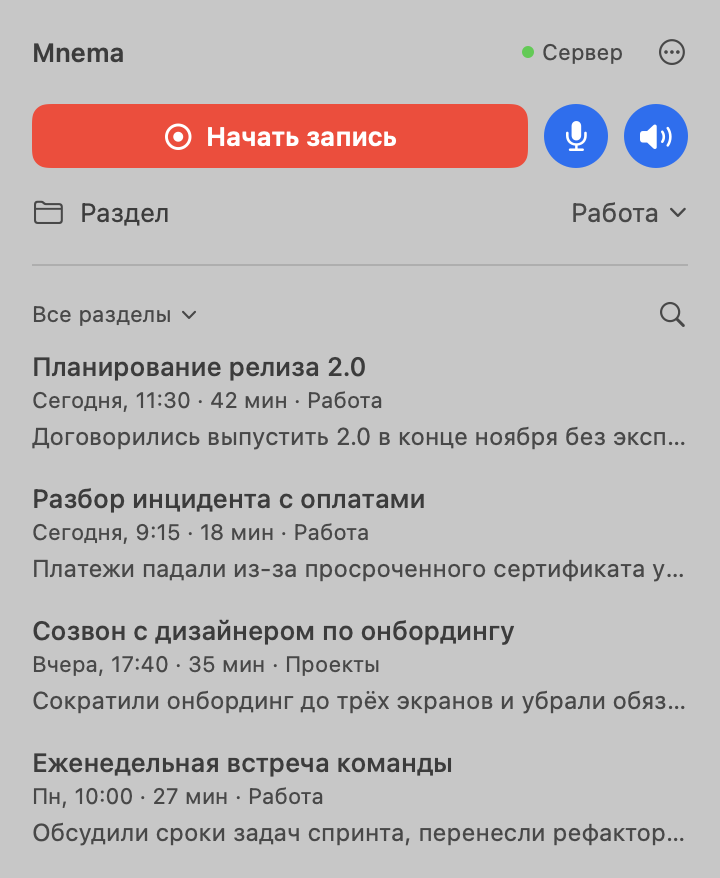

# Mnema

**Record a call, get a transcript and a short summary.** Speech is recognized on your Mac or on
your own server; only the transcript text goes to the language model you choose. One server can
serve several people, each with their own devices, library and model.


[Read this in Russian →](README.ru.md)

<p align="center">
  <picture>
    <source media="(prefers-color-scheme: dark)" srcset="docs/images/panel-dark.png">
    
  </picture>
</p>

## Features

- **One-click call recording** from the macOS menu bar, the Linux top panel or an Android phone.
  Your microphone and the other side of the call are kept as two separate tracks.
- **Local speech recognition**: Parakeet (25 European languages) and Whisper (everything else),
  plus GigaAM (Russian) on your server. No audio leaves your machines unless you choose cloud
  recognition (OpenAI).
- **A title and a short summary** of every call from a cloud model of your choice: Gemini,
  DeepSeek, OpenAI, Claude, Qwen, OpenRouter or Groq. Free tiers are enough for daily use. You
  choose the model in the Mac app; on a server it is kept per person.
- **Plain files you own**: every recording is a folder with `transcript.txt` and `summary.txt`,
  ready for Obsidian, an LLM or an archive.
- **Your own server** for Linux and the phone, with invites per device and sync of texts
  between all devices. Friends and family can share it: each person gets their own devices,
  recordings library, model and keys.
- **Command line** for files and links: transcribe a video or a YouTube link, translate,
  compress, merge tracks.
- **MCP server** so Claude and other assistants can transcribe and read your recordings.
- **English and Russian interface**, following the system language.

## How it works

```
Mac ─────────────── records, recognizes and summarizes on its own
                    (a server is optional: sync, recognition there, or the summary
                    with your model kept there)

Linux desktop ──┐
Android phone ──┼── record ──▶ your Mnema server ── recognizes and summarizes
Command line  ──┘               (with the model of the person who recorded)
```

A Mac needs nothing else. Linux and the phone don't recognize speech themselves: they send the
recording to a Mnema server you run on a Linux machine, at home or on a VPS. The server keeps
the model of every person who uses it, so a person's summaries are written by their own model
and their own key.

## Install

### Mac

Requirements: Apple Silicon, macOS 14.2 or later.

1. Download `Mnema-X.Y.Z.dmg` from [Releases](https://github.com/fozt/mnema/releases/latest), open
   it and drag Mnema to *Applications*. The app carries everything it needs: Python, the speech
   engines (Parakeet and Whisper) and ffmpeg.
2. Open Mnema from *Applications*. The app isn't notarized by Apple, so the first time macOS says
   it couldn't verify Mnema and offers only *Done* and *Move to Trash*: click *Done*, open *System
   Settings → Privacy & Security*, scroll down to *Security*, click *Open Anyway* next to "Mnema
   was blocked", confirm with your password or Touch ID, and click *Open Anyway* once more. macOS
   remembers the choice.
3. Click the Mnema icon in the menu bar, then *⋯ → Settings…*. On the *Recording* tab click
   *Choose model…* and pick a provider, paste its key and choose a model. Mnema checks the key and
   the model before saving. With a server connected, the model and its key are saved on the
   server, under your name; without one, on this Mac.
4. Click *Start recording*. macOS asks for microphone and system audio access the first time.

Speech models (about 1.3 GB) are downloaded on the first recording.

Opened straight from the disk image, Mnema asks to be moved to *Applications* first. On its first
start it turns on *Open at login* and links the `mnema` command to `~/.local/bin/mnema` unless
something else is already there. Updates come from GitHub Releases: *⋯ → Settings… → General →
Check for updates* downloads the new app and replaces this one in place, so Mnema has to stay in a
folder you can write to, such as *Applications*. To remove Mnema, turn off *Open at login*
(*Settings → General*), quit it, move it to the Trash and delete the `~/.local/bin/mnema` link if
Mnema made it; settings stay in `~/.config/mnema`, recordings in `~/mnema`. The licenses of
everything inside the app are in `Mnema.app/Contents/Resources/licenses`; the source code of its
LGPL and GPL parts is in `third-party-sources-X.Y.Z.tar.gz` on the same release page, except the
ones that `licenses/SOURCE-OFFER.txt` lists as on request.

### Server (Linux)

Needed for Linux desktops and the phone. The server runs in Docker on a Linux machine (x86_64 or
arm64), at home or on a VPS, and recognizes speech on the CPU. Install
[Docker Engine with the Compose plugin](https://docs.docker.com/engine/install/) first and give
the machine at least 6 GB of memory (the installer offers to add 4 GB of swap when there is
none; `--swap-size 4G` does it without asking, `--swap-size 0` never asks).

```bash
git clone https://github.com/fozt/mnema.git && cd mnema
./install.sh server
```

The installer starts the `mnema` container from the published image and prints an invite: a
link like `http://host:port#invite=…` that connects one device of the owner and expires in 6
hours. The server has no model of its own: each person sets theirs in the Mac app (see
[Choosing a model](#choosing-a-model)).

The invite carries the server's address, which the installer finds on its own (Tailscale, a public
IP or the home network). If devices reach the server another way, for example by a domain name or
through port forwarding on a router, give that address with `--url http://my.host:port`. Later
installs keep it.

Open the port the installer prints in your firewall. Docker publishes it past `ufw`, so `ufw`
rules do not close it: use your provider's firewall for that.

Everything lives in `~/mnema-server`: `compose.yaml` with its `.env`, and the data (settings,
recordings, devices, model weights) in `data/`. Nothing else is installed on the machine. The
server's commands run from the folder you cloned, next to `install.sh`:

```bash
cd ~/mnema && ./mnema.sh invite
```

| Command | What it does |
|---|---|
| `./mnema.sh invite` | A new invite for a device of the owner (`--hours` up to 72; `--user NAME` for a device of that person) |
| `./mnema.sh users` | People of the server with their devices and models |
| `./mnema.sh users add NAME` | Add a person and print their invite |
| `./mnema.sh users remove NAME` | Disconnect all of a person's devices; their recordings stay |
| `./mnema.sh devices` | Connected devices; `./mnema.sh devices revoke <id>` disconnects one |
| `./mnema.sh update` | Pull the latest image and restart the server with it |
| `./mnema.sh logs` | Server log |

`./install.sh server --build` builds the image from the checkout instead of pulling it.

The server speaks plain HTTP and requires a token from every device. If the network between your
devices and the server is not trusted, put a TLS proxy in front of it.

**A server installed with Mnema 0.3.0** ran as a systemd service. It does not update itself to the
Docker server, and the apps since 0.3.1 do not sync with it. Stop it with
`sudo systemctl disable --now mnema`, install the server as above and connect the devices with new
invites. Its data stays in place: recordings in `~/mnema-server/library`, settings in
`~/.config/mnema`.

**A server installed with Mnema 0.3.1** had a `mnema` command in `~/.local/bin`. Running
`./install.sh server` again removes that link; the commands are `./mnema.sh` now.

#### Several people on one server

Every person has their own devices, recordings library, model and keys. One person never sees
another's recordings, jobs, uploads or settings; the owner (the first user, whose invite the
installer prints) is a person like the others. To add someone:

```bash
cd ~/mnema && ./mnema.sh users add anna
```

Send the printed invite to that person. The name is lowercase Latin letters, digits, `-` and `_`.
`./mnema.sh invite --user anna` makes another invite for a person's second device, and
`./mnema.sh users remove anna` disconnects all of their devices at once. The recordings stay on
disk; adding the same name again brings them back.

When a device connects to a server whose recordings library is not the one it synced with
before, the app asks before sending its recordings there, so a recording cannot end up in someone
else's library by mistake.

The server's files are visible to whoever has access to its disk. The owner can read everyone's
recordings and model keys there: the library of the owner is `~/mnema-server/data/library`, of
anyone else `~/mnema-server/data/users/NAME/library`, models and keys are in
`~/mnema-server/data/config/mnema/users/NAME.env`. Add only people you trust with that.

#### Queue and memory

Recognition jobs from all people share one queue, and a free place goes to the person whose last
job started longest ago, so one long batch does not hold up the others. A recognition job starts
only when at least 5 GB of memory is free (or nothing else recognizes at that moment) and waits
otherwise. By default the server runs one recognition per three CPU cores and splits the cores
but one between the running ones. To set it by hand, add `MNEMA_JOB_WORKERS=2` (jobs at a time)
and `MNEMA_ASR_THREADS=8` (CPU threads of one job, or `auto` for all of them) to
`~/mnema-server/data/config/mnema/.env`. The threads apply to the next job, the number of jobs
after the server restarts (`./mnema.sh update` restarts it). Cloud recognition does not wait
on local jobs and uses no engine memory.

A server of 0.3 kept its model in that same `.env` (`MNEMA_MODEL`, `MNEMA_API_KEY`). Those lines
no longer work: set the model again from the app. Until a person does, their recordings come
back with a transcript and no summary.

### Linux desktop

Debian or Ubuntu with GNOME, KDE, Xfce, Cinnamon or MATE. On plain GNOME (Fedora, Arch) enable the
*AppIndicator and KStatusNotifierItem Support* extension.

```bash
git clone https://github.com/fozt/mnema.git && cd mnema
./install.sh client 'http://host:port#invite=…'
```

Mnema appears in the applications menu and in the top panel. Without a server it only records;
recordings are processed once you connect one in *Settings → Server*.

### Android

Android 14 or later. Recording the other side of a call is tested only on Pixel phones: on
other phones Mnema may record only your microphone, and it tells you when call audio is missing.

1. Download `mnema-X.Y.Z.apk` from [Releases](https://github.com/fozt/mnema/releases/latest) and
   install it (allow installs from your browser).
2. Follow the *Getting started* checklist: file access, notifications, no battery
   limits.
3. Start the recording helper. It needs Wi-Fi debugging, which is in *Developer options* (tap
   *Build number* seven times to unlock them). The app walks you through pairing; no computer is
   needed. After a reboot, start the helper again from the record screen.
4. In *Settings → Processing → Server* tap *Add server* and paste an invite from your server.

The phone records both sides of a call as two tracks and keeps recordings in
`Documents/Mnema`. It updates itself from *Settings → Updates*.

## Using Mnema

**Recordings** live in `~/mnema` on a computer and in `Documents/Mnema` on the phone. Each one is
a folder named after the call, for example `2026-10-21_Release planning`:

| File | What it is |
|---|---|
| `transcript.txt` | The transcript, in paragraphs, each marked `mic` (you) or `system` (the other side) |
| `summary.txt` | The gist in one or two sentences, then the main points |
| `recording.mp3` | Both tracks mixed together |
| `mic.wav`, `system.wav` | The original tracks |

Rename a recording in the app or in Finder: the folder name is its title. Folders inside `~/mnema`
are sections; move recordings between them from the card menu. Texts sync between your devices
through the server; audio stays where it was recorded.

**Language** is detected from the speech. If it comes out wrong, pick it in the menu of the
recording that is being processed, or in *⋯ → Process recording…* for an existing one.

**Without a model** you still get the transcript; the card offers *Summarize* once a model is
set.

### Recognition

*Settings → Recording → Processing → Recognition* says where speech is recognized:

| Place | Who recognizes | Engines |
|---|---|---|
| On this Mac (Mac only) | The Mac itself | Automatic, Parakeet, Whisper |
| On the server | Your server, on its CPU | Automatic and the engines installed there, GigaAM among them |
| In the cloud | OpenAI | `gpt-4o-transcribe`, `gpt-4o-mini-transcribe` |

*On the server* is unavailable until a server is connected. Linux offers *On the server* and *In
the cloud*. The title and the summary are written by your model in every case: a Mac connected to
a server recognizes on its own and asks the server's copy of your model for the summary. If the
server is unreachable you keep the transcript, and the card offers *Summarize* later.

**Cloud recognition sends the audio to OpenAI** and is paid per minute of speech by your OpenAI
account; the other places keep audio on your machines. It uses a key of its own: pick *In the
cloud* and Mnema asks for an OpenAI key (*Set the OpenAI key…*), which is checked and, with a
server connected, kept there under your name. That key has nothing to do with the summary model.
A Mac without a server reads it from `MNEMA_ASR_API_KEY` in `~/.config/mnema/.env`.

### Choosing a model

*Settings → Recording → Choose model…* (Mac). Any provider works; a key takes a minute to get:

| Provider | Where to get a key | Note |
|---|---|---|
| Gemini | [aistudio.google.com/apikey](https://aistudio.google.com/apikey) | Free tier, about 20 recordings a day per model |
| OpenRouter | [openrouter.ai/settings/keys](https://openrouter.ai/settings/keys) | Free models; allow them in the privacy settings |
| DeepSeek | [platform.deepseek.com/api_keys](https://platform.deepseek.com/api_keys) | Paid, very cheap |
| OpenAI, Claude, Qwen, Groq | the provider's console | Paid |

One recording costs one request. With a server connected, the window saves the model and the
key on the server under your name, and the server uses them for your recordings from every
device, Linux and phone included; they show the model but cannot change it yet. Keys are shown
only masked and are kept in a file readable by the server alone.

### Live translation

Live translation (`mnema live --translate` through a server) uses the model too. If you have a
DeepL key, set it in *Settings → Server → Set the DeepL key…* and the server translates phrases
with it, otherwise with your model.

## Command line

The Mac app and the installer link `mnema` into `~/.local/bin`; add that folder to `PATH` if your
shell doesn't have it.

```bash
mnema transcribe meeting.mov                    # → meeting.txt
mnema transcribe "https://youtu.be/VIDEO_ID"    # anything yt-dlp can download
mnema transcribe call.m4a --translate           # also a translation, call.ru.md
mnema rec --system                              # record mic and system audio, Ctrl-C to stop
mnema finish ~/mnema/2026-10-21_08-35 --from 0:10 --to 1:35   # process a part of a recording
mnema compress screen.mov                       # HEVC, roughly 9 GB → 1 GB
```

| Command | Purpose |
|---|---|
| `transcribe` | Speech to text; files, folders and links, several at once |
| `translate` | Translate a transcript or a media file with the model |
| `rec`, `finish` | Record a call; process a saved recording or a part of it |
| `live` | Live captions and live translation through a server |
| `compress`, `concat`, `merge`, `mp3` | Compress video, join files, mix tracks, extract audio |
| `users`, `invite`, `devices` | Manage the people and devices of a server (on the server) |
| `update` | Update Mnema |

On a Mac commands run locally; on Linux they run on the connected server. `--local` and
`--runner URL` choose explicitly. For YouTube videos that require sign-in add
`--cookies-from-browser chrome`.

### Claude and other assistants

`mnema-mcp` is an MCP server with four tools: `transcribe`, `translate`, `list_recordings` and
`read_transcript`. Add it to Claude Code:

```bash
claude mcp add mnema -- "$(dirname "$(readlink ~/.local/bin/mnema)")/mnema-mcp"
```

## Privacy

- **Audio** stays on the device that recorded it, or goes to your own server when that server
  processes it.
- **The model provider** receives only the transcript text, to write the title and the summary.
  On a shared server that is the provider each person chose, with their key.
- **Sync** carries texts only: `transcript.txt`, `summary.txt` and processing history.
- **Cloud recognition** sends the audio to OpenAI and is off unless a person chooses *In the
  cloud*; it is paid on their OpenAI account.
- **On a shared server** people's recordings, jobs and keys are separate from each other, but
  the owner of the server can read all of them on its disk.
- **Updates** are checked against GitHub Releases.

## Troubleshooting

- **Log:** `~/.cache/mnema/bar.log` on a computer, `./mnema.sh logs` on the server.
- **No notifications on a Mac:** allow Mnema in *System Settings → Notifications*.
- **No microphone or call audio:** allow Mnema in *System Settings → Privacy & Security →
  Microphone* and *Screen & System Audio Recording*.
- **The phone can't start the helper:** turn on Wi-Fi debugging and stay on Wi-Fi.
- **"Update the app" or "Update the server":** the app and the server run different Mnema
  versions (the first two numbers differ). Update the side the notice names.

## Development

See [CONTRIBUTING.md](CONTRIBUTING.md): building from source, the architecture, tests and
releases.

## License

[MIT](LICENSE)
