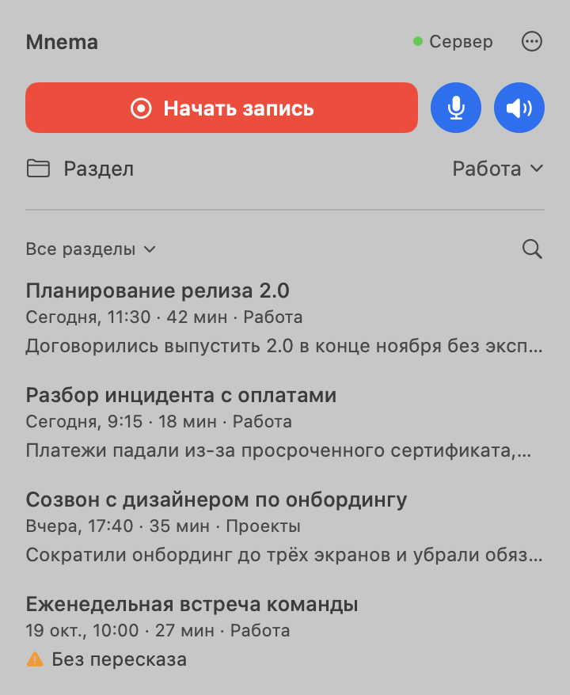

# Mnema

**Записываете звонок — получаете расшифровку и краткий пересказ.** Речь распознаётся на вашем Mac
или на вашем сервере; выбранной языковой модели уходит только текст расшифровки.


[English →](README.md)

<p align="center">
  <picture>
    <source media="(prefers-color-scheme: dark)" srcset="docs/images/panel-dark.ru.png">
    
  </picture>
</p>

## Возможности

- **Запись звонка в один щелчок** из строки меню macOS, верхней панели Linux или с телефона на
  Android. Ваш микрофон и собеседники пишутся двумя отдельными дорожками.
- **Распознавание речи без облака**: Parakeet (25 европейских языков) и Whisper (остальные), а на
  вашем сервере ещё GigaAM (русский). Звук никуда не отправляется.
- **Название и краткий пересказ** каждого звонка делает облачная модель на ваш выбор: Gemini,
  DeepSeek, OpenAI, Claude, Qwen, OpenRouter или Groq. Бесплатных тарифов хватает на каждый день.
- **Обычные файлы**: каждая запись — папка с `transcript.txt` и `summary.txt`, их можно сразу
  отдать Obsidian, языковой модели или в архив.
- **Свой сервер** для Linux и телефона: приглашение на каждое устройство и синхронизация текстов
  между всеми устройствами.
- **Командная строка** для файлов и ссылок: расшифровать видео или ссылку на YouTube, перевести,
  сжать, свести дорожки.
- **MCP-сервер**: Claude и другие ассистенты могут расшифровывать и читать ваши записи.
- **Интерфейс на русском и английском**, по языку системы.

## Как это устроено

```
Mac ─────────────── записывает, распознаёт и пересказывает сам
                    (сервер по желанию: синхронизация или обработка на нём)

Linux ──────────┐
Телефон ────────┼── запись ──▶ ваш сервер Mnema ── распознаёт и пересказывает
Командная строка┘
```

Маку больше ничего не нужно. Linux и телефон сами речь не распознают: они отправляют запись на
сервер Mnema, который вы ставите на Linux-машину дома или на VPS.

## Установка

### Mac

Нужен Mac на Apple Silicon с macOS 14.2 или новее.

1. Скачайте `Mnema-X.Y.Z.dmg` со страницы [Releases](https://github.com/fozt/mnema/releases/latest),
   откройте его и перетащите Mnema в «Программы». Всё нужное у приложения с собой: Python, движки
   распознавания (Parakeet и Whisper) и ffmpeg.
2. Откройте Mnema из «Программ». Приложение не заверено Apple, поэтому в первый раз macOS скажет,
   что не может проверить Mnema, и предложит только «Готово» и «Переместить в Корзину»: нажмите
   «Готово», откройте «Системные настройки → Конфиденциальность и безопасность», пролистайте до
   раздела «Безопасность», нажмите «Всё равно открыть» рядом со строкой о том, что Mnema
   заблокирована, подтвердите паролем или Touch ID и ещё раз нажмите «Всё равно открыть». macOS
   запомнит выбор.
3. Щёлкните значок Mnema в строке меню, затем «⋯ → Настройки…». На вкладке «Запись» нажмите
   «Выбрать модель…»: выберите провайдера, вставьте ключ и выберите модель. Mnema проверит ключ и
   модель перед сохранением.
4. Нажмите «Начать запись». В первый раз macOS спросит доступ к микрофону и системному звуку.

Модели распознавания (около 1,3 ГБ) скачиваются при первой записи.

Открытая прямо с образа диска, Mnema сначала попросит перенести её в «Программы». При первом
запуске она включает «Открывать при входе в систему» и ставит ссылку на команду `mnema` в
`~/.local/bin/mnema`, если это место не занято чужим файлом. Обновления приходят с GitHub
Releases: «⋯ → Настройки… → Общие → Проверить обновления» скачивает новое приложение и заменяет
им это на месте, поэтому Mnema должна лежать в папке, куда можно писать, например в «Программах».
Удалить Mnema: выключите «Открывать при входе в систему» («Настройки → Общие»), выйдите из неё,
перенесите в Корзину и удалите ссылку `~/.local/bin/mnema`, если её поставила Mnema; настройки
останутся в `~/.config/mnema`, записи — в `~/mnema`. Лицензии всего, что внутри приложения, — в
`Mnema.app/Contents/Resources/licenses`, исходный код его частей под LGPL и GPL — в
`third-party-sources-X.Y.Z.tar.gz` на той же странице выпуска, кроме тех, что
`licenses/SOURCE-OFFER.txt` называет предоставляемыми по запросу.

### Сервер (Linux)

Нужен для Linux и телефона. Сервер работает в Docker на машине с Linux (x86_64 или arm64), дома
или на VPS, и распознаёт речь на процессоре. Сначала поставьте
[Docker Engine с плагином Compose](https://docs.docker.com/engine/install/) и дайте машине не
меньше 6 ГБ памяти (или добавьте подкачку флагом `--swap-size 4G`).

```bash
git clone https://github.com/fozt/mnema.git && cd mnema
./install.sh server
```

Установщик запускает контейнер `mnema` из опубликованного образа, спрашивает модель для названий и
пересказов и печатает приглашение — ссылку вида `http://адрес:порт#invite=…`, которая подключает
одно устройство и действует 6 часов.

В приглашении записан адрес сервера, его установщик находит сам (Tailscale, внешний IP или
домашняя сеть). Если устройства видят сервер по-другому, например по доменному имени или через
проброс порта на роутере, укажите этот адрес: `--url http://my.host:порт`. Следующие установки
его сохраняют.

Откройте в файрволе порт, который напечатает установщик. Docker открывает его в обход `ufw`,
правила `ufw` его не закрывают: для этого есть файрвол провайдера.

Всё лежит в `~/mnema-server`: `compose.yaml` с его `.env` и данные (настройки, записи, устройства,
веса моделей) в `data/`. На сервере команда `mnema` выполняется в контейнере:

| Команда | Что делает |
|---|---|
| `mnema model` | Выбрать модель для названий и пересказов |
| `mnema invite` | Новое приглашение (`--hours` до 72) |
| `mnema devices` | Подключённые устройства; `mnema devices revoke <id>` отключает одно |
| `mnema update` | Скачать последний образ и перезапустить с ним сервер |
| `docker logs -f mnema` | Журнал сервера |

`./install.sh server --build` собирает образ из этой папки, а не скачивает его.

Речь распознаётся в 4 потока процессора. Чтобы изменить это, добавьте `MNEMA_ASR_THREADS=8`
(число или `auto` — все) в `~/mnema-server/data/config/mnema/.env`; следующая запись возьмёт его.

Сервер работает по обычному HTTP и требует токен от каждого устройства. Если сеть между
устройствами и сервером недоверенная, поставьте перед ним TLS-прокси.

**Сервер, установленный Mnema 0.3.0**, работал службой systemd. Сам до сервера в Docker он не
обновится, а приложения 0.3.1 с ним не синхронизируются. Остановите его командой
`sudo systemctl disable --now mnema`, установите сервер, как описано выше, и подключите устройства
новыми приглашениями. Его данные остаются на месте: записи в `~/mnema-server/library`, настройки в
`~/.config/mnema`.

### Linux

Debian или Ubuntu с GNOME, KDE, Xfce, Cinnamon или MATE. На чистом GNOME (Fedora, Arch) включите
расширение «AppIndicator and KStatusNotifierItem Support».

```bash
git clone https://github.com/fozt/mnema.git && cd mnema
./install.sh client 'http://адрес:порт#invite=…'
```

Mnema появится в меню приложений и в верхней панели. Без сервера она только записывает; записи
обработаются, когда вы подключите сервер в «Настройки → Сервер».

### Android

Android 14 или новее. Запись собеседника проверена только на телефонах Pixel: на других Mnema
может записать только ваш микрофон и сама скажет, если звук звонка не пишется.

1. Скачайте `mnema-X.Y.Z.apk` со страницы
   [Releases](https://github.com/fozt/mnema/releases/latest) и установите (разрешите установку из
   браузера).
2. Пройдите список «Начало работы»: доступ к файлам, уведомления, без ограничений батареи.
3. Запустите помощника записи. Ему нужна «Отладка по Wi-Fi» из «Параметров разработчика» (чтобы
   их открыть, семь раз нажмите «Номер сборки»). Приложение проведёт через сопряжение, компьютер не
   нужен. После перезагрузки запустите помощника снова с экрана записи.
4. В «Настройки → Обработка → Сервер» нажмите «Добавить сервер» и вставьте приглашение с сервера.

Телефон пишет обе стороны звонка двумя дорожками и хранит записи в `Documents/Mnema`. Обновляется
сам: «Настройки → Обновление».

## Как пользоваться

**Записи** лежат в `~/mnema` на компьютере и в `Documents/Mnema` на телефоне. Каждая — папка с
названием звонка, например `2026-10-21_Планирование релиза`:

| Файл | Что это |
|---|---|
| `transcript.txt` | Расшифровка по абзацам, у каждого пометка `mic` (вы) или `system` (собеседники) |
| `summary.txt` | Суть в одном-двух предложениях, затем главные пункты |
| `recording.mp3` | Обе дорожки вместе |
| `mic.wav`, `system.wav` | Исходные дорожки |

Переименовать запись можно в приложении или в Finder: имя папки и есть название. Папки внутри
`~/mnema` — разделы; переносить записи между ними можно из меню карточки. Тексты синхронизируются
между устройствами через сервер, звук остаётся там, где записан.

**Язык** определяется по речи. Если он определился неверно, выберите его в меню записи, которая
обрабатывается, или в «⋯ → Обработать запись…» для готовой.

**Без модели** расшифровка всё равно будет; когда модель появится, в карточке будет «Составить
пересказ».

### Какую модель выбрать

Подойдёт любой провайдер, ключ получается за минуту:

| Провайдер | Где взять ключ | Заметка |
|---|---|---|
| Gemini | [aistudio.google.com/apikey](https://aistudio.google.com/apikey) | Бесплатно, около 20 записей в день на модель |
| OpenRouter | [openrouter.ai/settings/keys](https://openrouter.ai/settings/keys) | Бесплатные модели; разрешите их в настройках приватности |
| DeepSeek | [platform.deepseek.com/api_keys](https://platform.deepseek.com/api_keys) | Платно, очень дёшево |
| OpenAI, Claude, Qwen, Groq | консоль провайдера | Платно |

Одна запись — один запрос. На сервере те же шаги делает `mnema model`.

## Командная строка

Приложение на Маке и установщик ставят ссылку `mnema` в `~/.local/bin`; добавьте эту папку в
`PATH`, если её там нет.

```bash
mnema transcribe meeting.mov                    # → meeting.txt
mnema transcribe "https://youtu.be/VIDEO_ID"    # всё, что умеет скачать yt-dlp
mnema transcribe call.m4a --translate           # и перевод, call.ru.md
mnema rec --system                              # запись микрофона и системного звука, Ctrl-C — стоп
mnema finish ~/mnema/2026-10-21_08-35 --from 0:10 --to 1:35   # обработать часть записи
mnema compress screen.mov                       # HEVC, примерно 9 ГБ → 1 ГБ
```

| Команда | Назначение |
|---|---|
| `transcribe` | Речь в текст; файлы, папки и ссылки, можно несколько сразу |
| `translate` | Перевести расшифровку или медиафайл моделью |
| `rec`, `finish` | Записать звонок; обработать сохранённую запись или её часть |
| `live` | Живые субтитры и живой перевод через сервер |
| `compress`, `concat`, `merge`, `mp3` | Сжать видео, склеить файлы, свести дорожки, извлечь звук |
| `model`, `update` | Выбрать модель, обновить Mnema |

На Маке команды работают на нём самом, на Linux — на подключённом сервере; `--local` и
`--runner URL` выбирают явно. Для видео YouTube, которые требуют входа, добавьте
`--cookies-from-browser chrome`.

### Claude и другие ассистенты

`mnema-mcp` — MCP-сервер с четырьмя инструментами: `transcribe`, `translate`, `list_recordings` и
`read_transcript`. Подключить к Claude Code:

```bash
claude mcp add mnema -- "$(dirname "$(readlink ~/.local/bin/mnema)")/mnema-mcp"
```

## Приватность

- **Звук** остаётся на устройстве, которое его записало, или уходит на ваш сервер, если
  обрабатывает он.
- **Провайдер модели** получает только текст расшифровки — чтобы написать название и пересказ.
- **Синхронизация** переносит только тексты: `transcript.txt`, `summary.txt` и историю обработки.
- **Облачное распознавание** (Groq, OpenAI) выключено, пока вы не выберете его на своём сервере.
- **Обновления** проверяются на GitHub Releases.

## Если что-то не работает

- **Журнал:** `~/.cache/mnema/bar.log` на компьютере, `docker logs mnema` на сервере.
- **Нет уведомлений на Маке:** разрешите их для Mnema в «Системные настройки → Уведомления».
- **Не пишется микрофон или звук звонка:** разрешите Mnema доступ в «Системные настройки →
  Конфиденциальность и безопасность → Микрофон» и «Запись экрана и системного звука».
- **Телефон не запускает помощника:** включите «Отладку по Wi-Fi» и оставайтесь в сети Wi-Fi.

## Разработка

Сборка из исходников, устройство кода, тесты и выпуски — в [CONTRIBUTING.md](CONTRIBUTING.md).

## Лицензия

[MIT](LICENSE)
