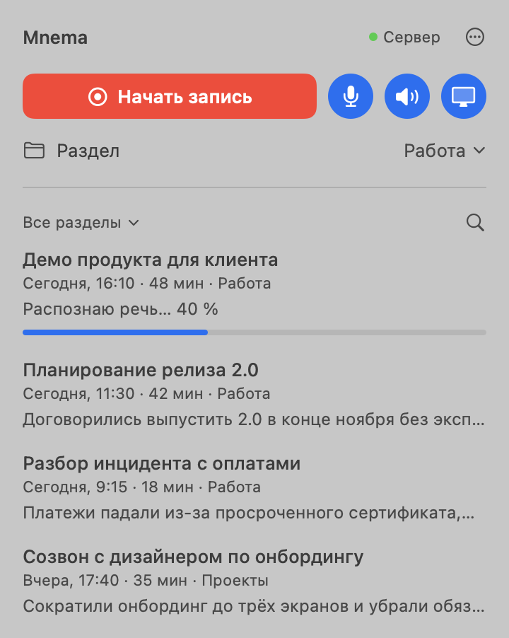
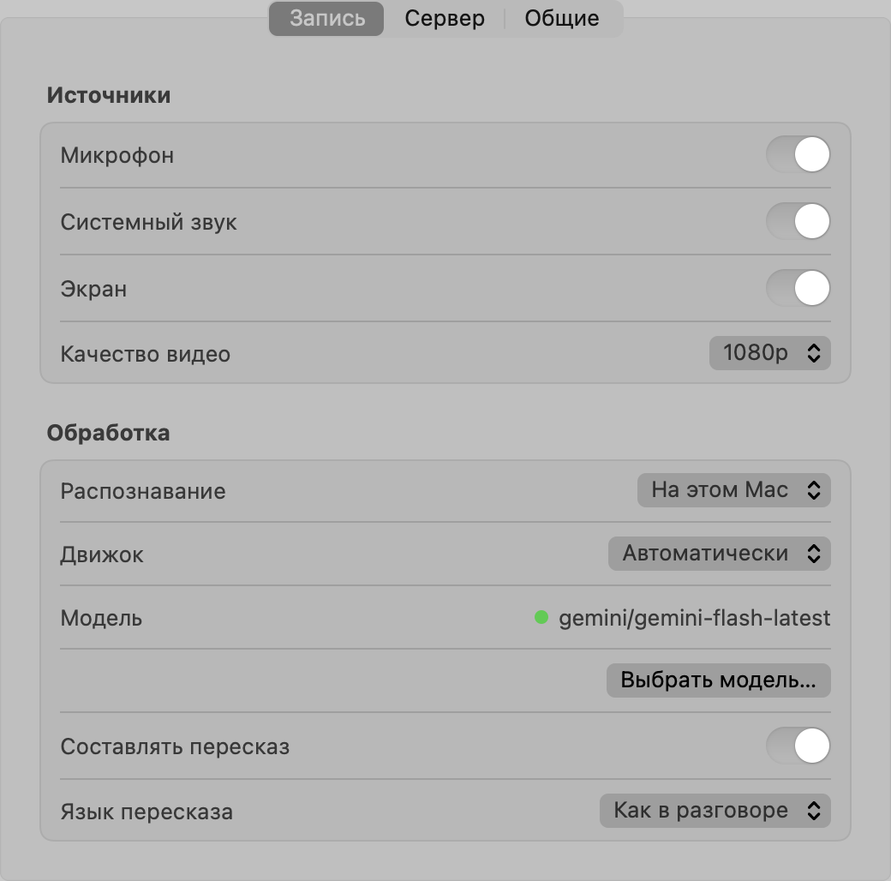

# Mnema

**Записываете звонок — получаете расшифровку и краткий пересказ.** Речь распознаётся на вашем Mac
или на вашем сервере; выбранной языковой модели уходит только текст расшифровки. Один сервер может
обслуживать нескольких человек: у каждого свои устройства, библиотека и модель.


[English →](README.md)

<p align="center">
  <picture>
    <source media="(prefers-color-scheme: dark)" srcset="docs/images/panel-dark.ru.png">
    
  </picture>
</p>

## Возможности

- **Запись звонка в один щелчок** из строки меню macOS, верхней панели Linux или с телефона на
  Android. Ваш микрофон и собеседники пишутся двумя отдельными дорожками. На Mac можно писать и
  экран: получится один `video.mp4` со звуком.
- **Распознавание речи без облака** моделью Parakeet Ultra: 25 европейских языков, на Neural
  Engine вашего Mac или на процессоре вашего сервера. Звук не уходит с ваших машин, пока вы не
  выберете облачное распознавание (OpenAI); оно же единственное для языков, которых у Parakeet нет.
- **Название и краткий пересказ** каждой записи с текстом делает облачная модель на ваш выбор:
  Gemini, DeepSeek, OpenAI, Claude, Qwen, OpenRouter или Groq. Бесплатных тарифов хватает на
  каждый день. Модель выбирают в приложении на Маке; на сервере она хранится у каждого человека
  своя.
- **Обычные файлы**: каждая запись — папка с `transcript.txt` и `summary.txt`, их можно сразу
  отдать Obsidian, языковой модели или в архив.
- **Свой сервер** для Linux и телефона: приглашение на каждое устройство и синхронизация текстов
  между всеми устройствами. Друзья и семья могут пользоваться им вместе: у каждого свои
  устройства, библиотека записей, модель и ключи.
- **Командная строка** (отдельный пакет) для файлов и ссылок: расшифровать видео или ссылку на
  YouTube, живые субтитры, перевести, сжать, свести дорожки.
- **MCP-сервер**: Claude и другие ассистенты могут расшифровывать и читать ваши записи.
- **API, совместимый с OpenAI**, на вашем сервере: другие сервисы могут распознавать вашим Parakeet.
- **Интерфейс на русском и английском**, по языку системы.

## Как это устроено

```
Mac ─────────────── записывает, распознаёт и пересказывает сам
                    (сервер по желанию: синхронизация, распознавание на нём или
                    пересказ вашей моделью, которая хранится там)

Linux ──────────┐
Телефон ────────┼── запись ──▶ ваш сервер Mnema ── распознаёт и пересказывает
Командная строка┘                (моделью того, кто записал)
```

Маку больше ничего не нужно. Linux и телефон сами речь не распознают: они отправляют запись на
сервер Mnema, который вы ставите на Linux-машину дома или на VPS. Сервер хранит модель каждого, кто
им пользуется, поэтому пересказы человека пишет его модель по его ключу.

## Установка

### Mac

Нужен Mac на Apple Silicon с macOS 14.2 или новее.

1. Скачайте `Mnema-X.Y.Z.dmg` (около 84 МБ) со страницы
   [Releases](https://github.com/fozt/mnema/releases/latest), откройте его и перетащите Mnema в
   «Программы». Нужное у приложения с собой: Python, ffmpeg и `mnema-asr`, программа, которая
   распознаёт речь на Neural Engine.
2. Откройте Mnema из «Программ». Приложение не заверено Apple, поэтому в первый раз macOS скажет,
   что не может проверить Mnema, и предложит только «Готово» и «Переместить в Корзину»: нажмите
   «Готово», откройте «Системные настройки → Конфиденциальность и безопасность», пролистайте до
   раздела «Безопасность», нажмите «Всё равно открыть» рядом со строкой о том, что Mnema
   заблокирована, подтвердите паролем или Touch ID и ещё раз нажмите «Всё равно открыть». macOS
   запомнит выбор.
3. Щёлкните значок Mnema в строке меню, затем «⋯ → Настройки…». На вкладке «Запись» нажмите
   «Выбрать модель…»: выберите провайдера, вставьте ключ и выберите модель. Mnema проверит ключ и
   модель перед сохранением. Если подключён сервер, модель и ключ сохраняются на сервере под вашим
   именем, если нет — на этом Mac.
4. Нажмите «Начать запись». В первый раз macOS спросит доступ к микрофону и системному звуку.

<p align="center">
  <picture>
    <source media="(prefers-color-scheme: dark)" srcset="docs/images/settings-dark.ru.png">
    
  </picture>
</p>

**Видео экрана.** Включите «Экран» рядом с «Микрофоном» и «Системным звуком», и вместе со звуком
запишется экран, на котором было активное окно. macOS спросит доступ к записи экрана, когда вы
включите переключатель, и применит его после перезапуска Mnema, поэтому после разрешения закройте
Mnema и откройте снова; до этого у переключателя будет «Нужно разрешение». После обработки в папке
записи появляется один `video.mp4` со звуком, а в меню карточки — «Открыть видео». «Настройки →
Запись → Качество видео» действует со следующей записи: 1080p (по умолчанию, мелкий текст
читается, до ~0,9 ГБ в час, на спокойном экране ~0,4 ГБ) или 720p (до ~0,5 ГБ в час).

Окна самой Mnema не попадают ни в видео, ни в показ экрана, ни в снимки экрана. Пока пишется
экран, macOS показывает в строке меню свой значок записи, и Mnema его не скрыть: чтобы строка меню
не попала в показ, показывайте в звонке окно, а не весь экран. «Скрывать запись в строке меню»
(«Настройки → Общие» или панель во время записи) делает значок самой Mnema обычным. Видео
собирается и остаётся на этом Mac, даже когда речь распознаёт сервер: никуда не уходит и не
сверяется. В меню записи есть «Удалить звук» и «Удалить видео»; «⋯ → Удалить звук и видео…»
спрашивает, что из двух убрать у всех обработанных записей (звук отмечен, видео нет). Удалённое
уходит в Корзину, тексты остаются.

Модели распознавания (около 630 МБ) в приложении нет: Mnema скачивает её один раз, когда вы
выбираете распознавание «На этом Mac» или делаете первую запись без неё, и показывает ход в строке
«Модель распознавания» в «Настройки → Запись»; пока модели нет, в этой строке есть кнопка
«Скачать». Нужны место на диске и подключение к сети; модель лежит в
`~/Library/Application Support/Mnema/models`.

Открытая прямо с образа диска, Mnema сначала попросит перенести её в «Программы». При первом
запуске она включает «Открывать при входе в систему». Команду `mnema` и `mnema-mcp` ставят
отдельно (см. [Командная строка](#командная-строка)). Обновления приходят с GitHub
Releases: «⋯ → Настройки… → Общие → Проверить обновления» ищет новую версию, а если она есть,
«Обновить» скачивает её и заменяет ею это приложение на месте, поэтому Mnema должна лежать в
папке, куда можно писать, например в «Программах».
Если изменился только код самой Mnema, обновление весит около 4 МБ, а не всё приложение.
Удалить Mnema: выключите «Открывать при входе в систему» («Настройки → Общие»), выйдите из неё и
перенесите в Корзину; настройки останутся в `~/.config/mnema`, записи — в `~/mnema`, модель
распознавания — в `~/Library/Application Support/Mnema`. Лицензии всего, что внутри приложения, —
в `Mnema.app/Contents/Resources/licenses`, исходный код его частей под LGPL и GPL — в
`third-party-sources-X.Y.Z.tar.gz` на той же странице выпуска, кроме тех, что
`licenses/SOURCE-OFFER.txt` называет предоставляемыми по запросу. У моделей распознавания свои
лицензии, см. [Модели распознавания](#модели-распознавания).

### Сервер (Linux)

Нужен для Linux и телефона. Сервер работает в Docker на машине с Linux (x86_64 или arm64), дома
или на VPS, и распознаёт речь на процессоре. Сначала поставьте
[Docker Engine с плагином Compose](https://docs.docker.com/engine/install/). Задаче распознавания
нужно до 2 ГБ памяти; если подкачки нет, установщик предложит добавить 4 ГБ (`--swap-size 4G`
добавляет без вопроса, `--swap-size 0` не спрашивает никогда).

```bash
git clone https://github.com/fozt/mnema.git && cd mnema
./install.sh server
```

Установщик запускает контейнер `mnema` из опубликованного образа. Речь распознаёт Parakeet Ultra
на ONNX Runtime, на процессоре; модель (около 910 МБ) скачивается в `data/cache` при первой
задаче. Установщик печатает приглашение — ссылку вида `http://адрес:порт#invite=…`, которая
подключает одно устройство владельца и действует 6 часов. У сервера нет своей модели: каждый
человек задаёт свою в приложении на Маке (см. [Какую модель выбрать](#какую-модель-выбрать)).

В приглашении записан адрес сервера, его установщик находит сам (Tailscale, внешний IP или
домашняя сеть). Если устройства видят сервер по-другому, например по доменному имени или через
проброс порта на роутере, укажите этот адрес: `--url http://my.host:порт`. Следующие установки
его сохраняют.

Откройте в файрволе порт, который напечатает установщик. Docker открывает его в обход `ufw`,
правила `ufw` его не закрывают: для этого есть файрвол провайдера.

Всё лежит в `~/mnema-server`: `compose.yaml` с его `.env` и данные (настройки, записи, устройства,
веса моделей) в `data/`. Больше на машину ничего не ставится. Команды сервера запускаются из
скачанной папки, рядом с `install.sh`:

```bash
cd ~/mnema && ./mnema.sh invite
```

| Команда | Что делает |
|---|---|
| `./mnema.sh invite` | Новое приглашение для устройства владельца (`--hours` до 72; `--user ИМЯ` — для устройства этого человека) |
| `./mnema.sh users` | Люди сервера с их устройствами и моделями |
| `./mnema.sh users add ИМЯ` | Добавить человека и напечатать его приглашение |
| `./mnema.sh users remove ИМЯ` | Отключить все устройства человека; его записи остаются |
| `./mnema.sh devices` | Подключённые устройства; `./mnema.sh devices revoke <id>` отключает одно |
| `./mnema.sh update` | Скачать последний образ и перезапустить с ним сервер, всегда: изменённые настройки сервера вступают в силу |
| `./mnema.sh logs` | Журнал сервера |

`./install.sh server --build` собирает образ из этой папки, а не скачивает его.

Сервер работает по обычному HTTP и требует токен от каждого устройства. Если сеть между
устройствами и сервером недоверенная, поставьте перед ним TLS-прокси.

#### Несколько человек на одном сервере

У каждого человека свои устройства, библиотека записей, модель и ключи. Записи, задачи, загрузки и
настройки одного не видны другому; владелец (первый пользователь, чьё приглашение печатает
установщик) такой же человек, как остальные. Добавить человека:

```bash
cd ~/mnema && ./mnema.sh users add anna
```

Отправьте напечатанное приглашение этому человеку. Имя — строчные латинские буквы, цифры, `-` и
`_`. `./mnema.sh invite --user anna` делает ещё одно приглашение для второго устройства человека, а
`./mnema.sh users remove anna` разом отключает все его устройства. Записи остаются на диске;
если добавить то же имя снова, они вернутся.

Когда устройство подключается к серверу, чья библиотека записей не та, с которой оно
синхронизировалось раньше, приложение спрашивает, отправлять ли туда записи: так запись не попадёт
в чужую библиотеку по ошибке.

Файлы сервера видит тот, у кого есть доступ к его диску. Владелец может прочитать там записи и
ключи моделей всех: библиотека владельца лежит в `~/mnema-server/data/library`, остальных — в
`~/mnema-server/data/users/ИМЯ/library`, модели и ключи — в
`~/mnema-server/data/config/mnema/users/ИМЯ.env`. Добавляйте только тех, кому доверяете это.

#### Очередь и память

Задачи распознавания всех людей стоят в одной очереди, освободившееся место достаётся тому, чья
последняя задача началась раньше всех, поэтому длинная пачка одного не задерживает остальных.
Распознавание начинается, только когда свободно не меньше 2 ГБ памяти (или в этот момент ничего
больше не распознаётся), иначе ждёт. По умолчанию сервер ведёт одно распознавание на три ядра
процессора и делит между идущими все ядра, кроме одного. Чтобы задать вручную, добавьте
`MNEMA_JOB_WORKERS=2` (задач одновременно) и `MNEMA_ASR_THREADS=8` (потоков процессора на одну
задачу, или `auto` — все) в `~/mnema-server/data/config/mnema/.env`. Потоки подействуют со
следующей задачи, число задач — после перезапуска сервера (его выполняет `./mnema.sh update`).
Облачное распознавание не ждёт локальных задач и не занимает память под движок.

Пока человек не задал модель в приложении, его записи приходят с расшифровкой и без пересказа.

### Linux

Debian или Ubuntu с GNOME, KDE, Xfce, Cinnamon или MATE. На чистом GNOME (Fedora, Arch) включите
расширение «AppIndicator and KStatusNotifierItem Support».

```bash
git clone https://github.com/fozt/mnema.git && cd mnema
./install.sh client 'http://адрес:порт#invite=…'
```

Mnema появится в меню приложений и в верхней панели, а установщик добавит команду `mnema`. Без
сервера она только записывает: запись остаётся «Не обработана», а после подключения сервера в
«Настройки → Сервер» её можно обработать кнопкой «Обработать…» в её карточке.

### Android

Android 14 или новее. Запись собеседника проверена только на телефонах Pixel: на других Mnema
может записать только ваш микрофон и сама скажет, если звук звонка не пишется.

1. Скачайте `mnema-X.Y.Z.apk` со страницы [Releases](https://github.com/fozt/mnema/releases/latest)
   и установите (разрешите установку из браузера).
2. Пройдите список «Начало работы»: доступ к файлам, уведомления, без ограничений батареи.
3. Запустите помощника записи. Ему нужна «Отладка по Wi-Fi» из «Параметров разработчика» (чтобы
   их открыть, семь раз нажмите «Номер сборки»). Приложение проведёт через сопряжение, компьютер не
   нужен. После перезагрузки запустите помощника снова с экрана записи.
4. В «Настройки → Обработка → Сервер» нажмите «Добавить сервер» и вставьте приглашение с сервера.

Телефон пишет обе стороны звонка двумя дорожками и хранит записи в `Documents/Mnema`. Распознаёт
и пересказывает их подключённый сервер вашей моделью; новую запись можно начать, пока прошлая ждёт
в очереди сервера. В списке у записи дата, время и длина; долгое нажатие открывает
«Переименовать», «Переместить в раздел» и «Удалить запись», а смахивание влево предлагает её
удалить. Телефон обновляется сам: «Настройки → Обновление».

## Как пользоваться

**Записи** лежат в `~/mnema` на компьютере и в `Documents/Mnema` на телефоне. Каждая — папка с
названием звонка, например `2026-10-21_Планирование релиза`:

| Файл | Что это |
|---|---|
| `transcript.txt` | Расшифровка по абзацам, у каждого время и дорожка: `[12:34] mic:` (вы) или `system:` (собеседники) |
| `summary.txt` | Суть в одном-двух предложениях, затем главные пункты, у каждого время, когда о нём заговорили |
| `recording.mp3` | Обе дорожки вместе |
| `mic.wav`, `system.wav` | Исходные дорожки |
| `video.mp4` | Экран со звуком (Mac, когда включён «Экран») |

Переименовать запись можно в приложении или в Finder: имя папки и есть название. Папки внутри
`~/mnema` — разделы; переносить записи между ними можно из меню карточки. Тексты синхронизируются
между устройствами через сервер, звук и видео остаются там, где записаны. Запись, удалённая на
одном устройстве, при следующей синхронизации удаляется и на остальных: в Корзину, а на телефоне
без Корзины — насовсем.

Пока обрабатываются прошлые записи, новые ждут в очереди, поэтому начать запись можно в любой
момент; в карточке обрабатываемой записи видны шаг и ход.

**Язык** определяется по речи. Если он определился неверно, выберите его в меню записи, которая
обрабатывается, или в «⋯ → Обработать запись…» для готовой; выбранный язык сообщается облачному
распознаванию и используется для чистки текста и для пересказа. «Обработать запись…» заново
обрабатывает любую папку записи, целиком или часть, со своим названием, языком, распознаванием и
дорожками.

**Пересказ.** Когда включено «Составлять пересказ», у каждой записи с текстом будут название и
пересказ на языке из «Язык пересказа» (по умолчанию — как в разговоре). Без модели расшифровка всё
равно будет. У записи с текстом без пересказа (нет модели, модель не ответила или пересказ был
выключен) в меню есть «Составить пересказ».

### Распознавание

«Настройки → Запись → Обработка → Распознавание» говорит, где распознаётся речь:

| Место | Кто распознаёт | Движки |
|---|---|---|
| На этом Mac (только Mac) | Сам Mac, на Neural Engine | Автоматически, Parakeet |
| На сервере | Ваш сервер, на процессоре | Автоматически, Parakeet |
| В облаке | OpenAI | `gpt-4o-transcribe`, `gpt-4o-mini-transcribe` |

Parakeet Ultra распознаёт 25 языков: английский, болгарский, венгерский, греческий, датский,
испанский, итальянский, латышский, литовский, мальтийский, немецкий, нидерландский, польский,
португальский, румынский, русский, словацкий, словенский, украинский, финский, французский,
хорватский, чешский, шведский и эстонский, и язык определяет сам. Другим языкам нужно «В
облаке»: «Автоматически» их не определяет, и такая речь придёт неверной расшифровкой на одном из
этих 25 языков. Звук в облако сам не уходит, поэтому для такой записи выберите «В облаке» («⋯ →
Обработать запись…»). Только команда `mnema` с явным `--lang` не из списка получает вместо
расшифровки замечание «Этот язык распознаёт только облако».

«На сервере» недоступно, пока не подключён сервер. На Linux есть «На сервере» и «В облаке».
Название и пересказ в любом случае пишет ваша модель: Mac, подключённый к серверу, распознаёт сам
и просит у сервера пересказ вашей сохранённой там моделью. Если сервер недоступен, расшифровка
остаётся, а в карточке потом будет «Составить пересказ».

**Облачное распознавание отправляет звук в OpenAI** и оплачивается по минутам речи с вашего
аккаунта OpenAI; в остальных местах звук остаётся на ваших машинах. Ему нужен свой ключ: выберите
«В облаке», и Mnema попросит ключ OpenAI («Задать ключ OpenAI…»); его проверят и, если подключён
сервер, сохранят там под вашим именем. К ключу модели пересказа он отношения не имеет. Mac без
сервера берёт его из `MNEMA_ASR_API_KEY` в `~/.config/mnema/.env`.

### Какую модель выбрать

«Настройки → Запись → Выбрать модель…» (на Маке). Подойдёт любой провайдер, ключ получается за
минуту:

| Провайдер | Где взять ключ | Заметка |
|---|---|---|
| Gemini | [aistudio.google.com/apikey](https://aistudio.google.com/apikey) | Бесплатно, с дневным пределом на модель |
| OpenRouter | [openrouter.ai/settings/keys](https://openrouter.ai/settings/keys) | Бесплатные модели; разрешите их в настройках приватности |
| DeepSeek | [platform.deepseek.com/api_keys](https://platform.deepseek.com/api_keys) | Платно, очень дёшево |
| OpenAI, Claude, Qwen, Groq | консоль провайдера | Платно |

Одна запись — один запрос; расшифровка длиннее, чем модель принимает за раз, идёт частями. Если
подключён сервер, окно сохраняет модель и ключ на сервере под вашим именем, и сервер пользуется
ими для ваших записей со всех устройств, включая Linux и телефон; они показывают модель, а
выбирают её в приложении на Маке. Ключи показываются только в виде маски и лежат в файле, который
читает только сервер.

### Живой текст и перевод

`mnema live` показывает субтитры по ходу речи через сервер: фраза распознаётся, когда вы делаете
паузу (или через 15 секунд), вместе со звуком до 10 секунд перед ней для контекста, поэтому она
появляется чуть позже конца фразы, а не по слову. Живой перевод (`mnema live --translate`) тоже
использует модель. Если у вас есть ключ DeepL, задайте его в «Настройки → Сервер → Задать ключ
DeepL…», и сервер переводит фразы им, иначе вашей моделью.

## Командная строка

Команда — отдельный пакет, его ставят через [uv](https://docs.astral.sh/uv/) из колеса выпуска
(вместо `X.Y.Z` подставьте версию [последнего выпуска](https://github.com/fozt/mnema/releases/latest)):

```bash
uv tool install "mnema[cli] @ https://github.com/fozt/mnema/releases/download/vX.Y.Z/mnema-X.Y.Z-py3-none-any.whl" \
  --constraints https://github.com/fozt/mnema/releases/download/vX.Y.Z/mnema-X.Y.Z-constraints.txt
```

Файл ограничений задаёт версии зависимостей, с которыми проверен выпуск. Так ставятся `mnema` и
`mnema-mcp` в `~/.local/bin`; добавьте эту папку в `PATH`, если её там нет. Обновить можно той же
командой с `--force` (её печатает `mnema update`). На Маке команда распознаёт через установленное
приложение Mnema, поэтому поставьте и его, либо подключите сервер; на Linux она распознаёт на
процессоре Parakeet или на сервере. Установщик приложения на Linux добавляет команду сам.

```bash
mnema transcribe meeting.mov                    # → meeting.txt
mnema transcribe "https://youtu.be/VIDEO_ID"    # всё, что умеет скачать yt-dlp
mnema transcribe call.m4a --translate           # и перевод, call.ru.md
mnema rec --system                              # запись микрофона и системного звука, Ctrl-C — стоп
mnema finish ~/mnema/2026-10-21_08-35 --from 0:10 --to 1:35   # обработать часть записи
mnema compress screen.mov                       # HEVC, в разы меньше
```

| Команда | Назначение |
|---|---|
| `transcribe` | Речь в текст; файлы, папки и ссылки, можно несколько сразу |
| `translate` | Перевести расшифровку или медиафайл моделью |
| `rec`, `finish` | Записать звонок; обработать сохранённую запись или её часть |
| `live` | Живые субтитры по фразам и живой перевод через сервер |
| `compress`, `concat`, `merge`, `mp3` | Сжать видео, склеить файлы, свести дорожки, извлечь звук |
| `users`, `invite`, `devices` | Люди и устройства сервера (запускаются на сервере) |
| `update` | Обновить Mnema |

На Маке команды работают на нём самом, распознавателем приложения, если в приложении не выбрано
распознавание на сервере, на Linux — на подключённом сервере; `--local` и `--runner URL`
выбирают явно. Для видео YouTube, которые требуют входа, добавьте `--cookies-from-browser chrome`.

### Claude и другие ассистенты

`mnema-mcp` ставится вместе с командой и является MCP-сервером с четырьмя инструментами:
`transcribe` (файл или ссылка; расшифровка ещё и сохраняется вне библиотеки записей), `translate`,
`list_recordings` (библиотека записей этого компьютера) и `read_transcript`. Обрабатывает он там
же, где команда `mnema`. Подключить к Claude Code:

```bash
claude mcp add mnema -- mnema-mcp
```

### Другие сервисы

Сервер понимает и API расшифровки OpenAI: сервис, который умеет работать с OpenAI, может работать
с вашим сервером. Ему нужны три настройки:

| Настройка | Значение |
|---|---|
| Base URL | `http://СЕРВЕР:ПОРТ/api/v1` |
| API key | токен устройства |
| Model | `mnema` (подойдёт и `whisper-1`, для клиентов с жёстко заданным именем) |

Каждому сервису нужен свой токен. Выпустите приглашение на сервере и обменяйте код после
`#invite=` на токен:

```bash
cd ~/mnema && ./mnema.sh invite
```

```bash
curl http://СЕРВЕР:ПОРТ/api/devices/claim -H 'Content-Type: application/json' -d '{"invite": "КОД", "name": "мой сервис", "library": true}'
```

Сервис работает от того человека, для которого приглашение (`./mnema.sh invite --user anna`), а
`./mnema.sh devices revoke <id>` отключает его, как любое устройство. С пакетом `openai` для
Python:

```python
from openai import OpenAI

client = OpenAI(base_url="http://СЕРВЕР:ПОРТ/api/v1", api_key="ТОКЕН", timeout=3600)
with open("call.mp3", "rb") as audio:
    result = client.audio.transcriptions.create(model="mnema", file=audio)
print(result.text)
```

`POST /audio/transcriptions` принимает `file`, `model`, `language`, `prompt`, `response_format`
(`json`, `text`, `srt`, `vtt`, `verbose_json`) и, с `verbose_json`, `timestamp_granularities[]`
(`segment`, `word`). Ошибки приходят в формате OpenAI.

- **Токен только на бэкенде:** запрос идёт из вашего бэкенда, а не из браузера: иначе токен окажется у всех посетителей, и браузер такой запрос не пропустит.
- **Модели:** только Parakeet. Облачного распознавания здесь нет, поэтому сервис не потратит ключ
  OpenAI того человека, чей токен у него.
- **Поля без действия:** `prompt` и `temperature` принимаются и ничего не меняют, у Parakeet таких
  настроек нет. Поля уверенности в сегментах `verbose_json` заполнены постоянными значениями.
  Потоковый ответ не поддерживается.
- **Языки:** 25 языков Parakeet; `language` с другим языком сервер отклонит.
- **Размер:** запрос до 1 ГиБ. Этого хватает на часы звука и не опасно для диска общего сервера:
  пока файл сохраняется, он лежит на диске дважды. Записи длиннее идут через приложения, они
  загружают частями с докачкой.
- **Время:** запрос ждёт в той же очереди, что и записи. Полная очередь отвечает `429` с
  `Retry-After`. Через час, считая очередь, задача отменяется, ответ `504`.
- **Таймаут клиента:** закрытое соединение отменяет задачу. Пакет `openai` по умолчанию ждёт
  10 минут, поэтому задайте `timeout`, как в примере.
- **Что остаётся:** ничего. Звук и текст удаляются сразу после ответа, в библиотеке записи не
  появляется.
- **Открытый HTTP:** своего TLS у сервера нет, поэтому токен сервиса и звук идут открытым текстом.
  Если сеть недоверенная, поставьте перед сервером TLS-прокси.

## Приватность

- **Звук** остаётся на устройстве, которое его записало, или уходит на ваш сервер, если
  обрабатывает он.
- **Провайдер модели** получает только текст расшифровки — чтобы написать название и пересказ. На
  общем сервере это провайдер, которого выбрал каждый человек, с его ключом.
- **Синхронизация** переносит только тексты: `transcript.txt`, `summary.txt` и историю обработки,
  а ещё переименования, переносы и удаления.
- **Видео экрана** собирается и хранится на том Mac, который его записал.
- **API, совместимый с OpenAI,** ничего не хранит: звук и текст удаляются сразу после ответа.
- **Модели распознавания** скачиваются один раз с Hugging Face: на Маке при первом использовании,
  на сервере с первой задачей; само распознавание работает без сети.
- **Облачное распознавание** отправляет звук в OpenAI и выключено, пока человек не выберет «В
  облаке»; оплачивается с его аккаунта OpenAI.
- **На общем сервере** записи, задачи и ключи людей отделены друг от друга, но владелец сервера
  может прочитать всё это на его диске.
- **Обновления** проверяются на GitHub Releases.

## Если что-то не работает

- **Журнал:** `~/.cache/mnema/bar.log` на компьютере, `./mnema.sh logs` на сервере.
- **Нет уведомлений на Маке:** разрешите их для Mnema в «Системные настройки → Уведомления».
- **Не пишется микрофон или звук звонка:** разрешите Mnema доступ в «Системные настройки →
  Конфиденциальность и безопасность → Микрофон» и «Запись экрана и системного звука».
- **У «Экрана» написано «Нужно разрешение»:** разрешите Mnema доступ в «Запись экрана и
  системного звука», затем закройте её и откройте снова.
- **Телефон не запускает помощника:** включите «Отладку по Wi-Fi» и оставайтесь в сети Wi-Fi.
- **«Не удалось скачать модель распознавания»:** проверьте подключение и свободное место на диске
  и попробуйте ещё раз.
- **«Установите Mnema или подключите сервер» от команды `mnema` на Маке:** команда распознаёт
  через приложение Mnema, а его нет; поставьте его или укажите `--runner`.
- **«Обновите приложение» или «Обновите сервер» в панели:** у приложения и сервера разные версии
  Mnema (отличаются первые два числа). Обновите то, что названо.

## Модели распознавания

Mnema распознаёт речь моделью **Parakeet Ultra** и ищет паузы моделью silero VAD. Веса Parakeet
не входят ни в приложение, ни в репозиторий: они скачиваются при первом использовании. У моделей
свои лицензии.

- [NVIDIA parakeet-tdt-0.6b-v3](https://huggingface.co/nvidia/parakeet-tdt-0.6b-v3), базовая
  модель, автор NVIDIA (CC-BY-4.0).
- [parakeet-ultra](https://huggingface.co/moondream/parakeet-ultra), её дообучение, автор
  moondream (CC-BY-4.0).
- На Маке: конвертации в CoreML от FluidInference,
  [parakeet-ultra-coreml](https://huggingface.co/FluidInference/parakeet-ultra-coreml)
  (CC-BY-4.0) и [silero-vad-coreml](https://huggingface.co/FluidInference/silero-vad-coreml)
  (MIT), запускаются через [FluidAudio](https://github.com/FluidInference/FluidAudio) (Apache-2.0).
- На сервере и Linux: конвертации в ONNX
  [marcosremar2/parakeet-ultra-onnx](https://huggingface.co/marcosremar2/parakeet-ultra-onnx)
  (энкодер int8) и
  [Masterx/parakeet-tdt-0.6b-ultra-onnx](https://huggingface.co/Masterx/parakeet-tdt-0.6b-ultra-onnx)
  (декодер), обе под CC-BY-4.0.
- [silero VAD](https://github.com/snakers4/silero-vad), автор Silero (MIT); его ONNX-модель
  лежит внутри Mnema.

Текст CC-BY-4.0 — [creativecommons.org/licenses/by/4.0](https://creativecommons.org/licenses/by/4.0/).
Mnema берёт конвертации так, как их опубликовали авторы; файлы сервера закреплены по ревизии и
контрольной сумме.

## Разработка

Сборка из исходников, устройство кода, тесты и выпуски — в [CONTRIBUTING.md](CONTRIBUTING.md).

## Лицензия

[MIT](LICENSE)
